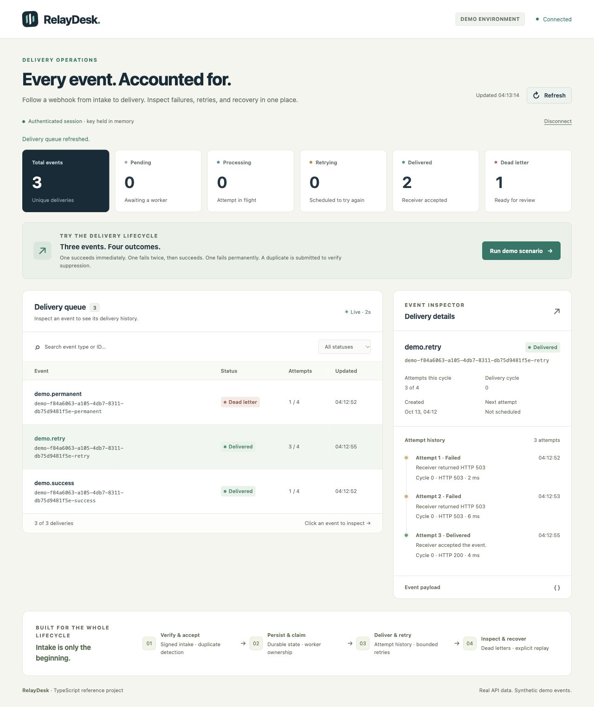

# RelayDesk

**A signed webhook delivery service with a durable queue and an operations dashboard.**

RelayDesk accepts a signed event, records it before acknowledging receipt, and delivers it to a configured receiver. It makes the difficult cases visible: duplicate events, conflicting payloads, temporary failures, exhausted retries, and a worker disappearing before its result is recorded.

An independent portfolio project by **Kaveh Fereidouni**, built with AI assistance. All examples and demo data are synthetic. This repository contains no PwC or other client code and does not represent a client deployment.



## Run it locally

Use **Node.js 24.15 or newer** and npm. No database server, account, API subscription, or cloud deployment is needed.

```sh
npm ci
npm run dev
```

Open [http://localhost:3000](http://localhost:3000) and enter the local demo admin key:

```text
sample-admin-key-change-me
```

In a second terminal:

```sh
npm run demo
```

The script sends signed HTTP requests to the running service and verifies duplicate and conflict handling, transient retries, and a permanent failure followed by recovery. It automatically repairs and replays its permanent-failure example, then prints its verification result. The dashboard reads the actual SQLite records. Its status counts and attempt history are not simulated charts.

For a manual recovery demonstration, click **Run demo scenario** in the dashboard after the script finishes. The demo receiver deliberately fails a transient event twice with HTTP 503 before accepting it. It rejects a permanent-failure event with HTTP 422 until you choose **Fix demo receiver & replay**. See the [four-minute walkthrough](docs/walkthrough.md).

Local defaults bind to `127.0.0.1:3000`, write `data/relaydesk.sqlite`, and enable the synthetic receiver. The dashboard keeps the entered key in memory; reloading requires it again. Keep the defaults on a trusted local machine.

The dashboard's demo action queues synthetic events directly through the admin API. `npm run demo` additionally exercises the public signature-verification boundary over HTTP.

For a different local port, set `BASE_URL` to the running service's URL when invoking the demo script. Its default is `http://127.0.0.1:3000`.

## What this demonstrates

- **Authenticated intake:** a timestamped HMAC signature over the exact request body, with a replay window and bounded JSON input.
- **Durable acceptance:** event insertion and delivery creation occur in one SQLite transaction before acknowledgement.
- **Explicit idempotency:** an event ID with the same canonical JSON payload is a duplicate; the same ID with different contents is a conflict.
- **Recoverable delivery:** a worker claims due work with a lease and a token, records each attempt, and retries temporary failures within a bounded budget.
- **Operational ownership:** inspect failures and their history, repair the downstream condition, and replay a dead delivery without erasing earlier attempts.
- **Honest delivery semantics:** the receiver may see an event more than once. This is **at-least-once delivery**, not exactly-once processing.

TypeScript, Fastify, Node's SQLite API, and a small browser dashboard keep the entire flow inspectable. The [architecture notes](docs/architecture.md) explain the state machine, failure windows, and tradeoffs.

## HTTP contract

| Endpoint                               | Authentication        | Behavior                                                                                              |
| -------------------------------------- | --------------------- | ----------------------------------------------------------------------------------------------------- |
| `POST /webhooks/events`                | `x-webhook-signature` | `202` for first intake, `200` for identical duplicate, `409` for changed payload under an existing ID |
| `GET /api/overview`                    | `x-api-key`           | Actual counts per state and total                                                                     |
| `GET /api/events?status=dead&limit=50` | `x-api-key`           | Bounded delivery summaries; the status filter is optional                                             |
| `GET /api/events/:id`                  | `x-api-key`           | Event payload and persistent attempt history                                                          |
| `POST /api/events/:id/replay`          | `x-api-key`           | Requeue a dead delivery; reject other states with `409`                                               |
| `GET /healthz`                         | None                  | Process liveness; not a downstream readiness guarantee                                                |

An event uses this shape:

```json
{
  "id": "evt-example-001",
  "type": "invoice.created",
  "occurredAt": "2026-10-13T00:00:00.000Z",
  "data": {
    "invoiceId": "synthetic-invoice-001",
    "amount": "49.00",
    "currency": "USD"
  }
}
```

Only those four top-level keys are accepted. The signature is `t=UNIX_SECONDS,v1=HEX_DIGEST`, where the digest is HMAC-SHA256 over `UNIX_SECONDS + "." + raw_body_bytes`. Send `Content-Type: application/json` and sign the exact bytes transmitted. The signature time must be within five minutes of the service clock; `occurredAt` is the event time and is a separate field. Requests are limited to 64 KiB.

Outgoing delivery uses the same signature format with `DELIVERY_SECRET`. The request includes `x-delivery-id` and `x-event-id`, and does not follow redirects. A successful response is any 2xx; network errors, timeouts, 408, 425, 429, and 5xx are retryable. Other failures are permanent. The receiver must deduplicate `x-delivery-id` across retries and manual replay.

## Verify the code

```sh
npm run check
npm run test:coverage
```

`check` compiles TypeScript, runs ESLint, checks formatting, and runs the tests. Coverage is generated from the tests; no coverage percentage is hard-coded in this README. The [CI workflow](.github/workflows/ci.yml) is configured for Node 24 and 26. A workflow configuration alone is not evidence that a GitHub run has passed.

## Configuration

The project reads environment variables. `.env.example` describes the defaults; it is a reference file and is **not loaded automatically** by the development command.

When using a real receiver, disable demo mode and supply independent `ADMIN_API_KEY`, `WEBHOOK_SECRET`, and `DELIVERY_SECRET` values plus an HTTPS `DELIVERY_URL`. The destination is configuration, never an arbitrary URL supplied in an event. Incoming and outgoing signatures use different secrets.

The demo credentials are public examples, not production secrets. Before exposing this service, choose a reverse-proxy authentication and rate-limit policy, an outbound network allowlist, secret storage and rotation, data-retention and backup procedures, and a receiver-side idempotency implementation. See [deployment boundaries](docs/architecture.md#deployment-boundaries).

## Container option

The included [Dockerfile](Dockerfile) builds the service in stages and runs as the unprivileged `node` user. A persistent volume is required to retain delivery history.

```sh
docker build -t relaydesk .
docker run --rm --name relaydesk \
  -p 127.0.0.1:3000:3000 \
  -v relaydesk-data:/app/data \
  -e HOST=0.0.0.0 \
  relaydesk
```

The host port remains local in this example. Container execution needs a Docker installation and must be validated in your environment; building and testing the Node application does not establish that the image works.

## Scope

RelayDesk is a single-service reference implementation for bounded workloads. SQLite operations are synchronous, and `node:sqlite` is marked Stability 1.2 (release candidate) in the [Node 24 documentation](https://nodejs.org/docs/latest-v24.x/api/sqlite.html). Using the built-in module keeps setup small; a real deployment should review its runtime and database-driver requirements. There is no multi-tenant access model, distributed scheduler, managed secret system, retention job, production monitoring stack, or benchmark-backed throughput claim. Two connections are useful for testing lease competition; that does not make this a horizontally scalable deployment design.

The strongest review questions are about behavior under failure: what was committed before an acknowledgement, which worker may finish an attempt, and what a downstream consumer must deduplicate.

[Walkthrough](docs/walkthrough.md) · [Architecture](docs/architecture.md) · [Portfolio description](docs/portfolio-copy.md)

Licensed under [MIT](LICENSE).
