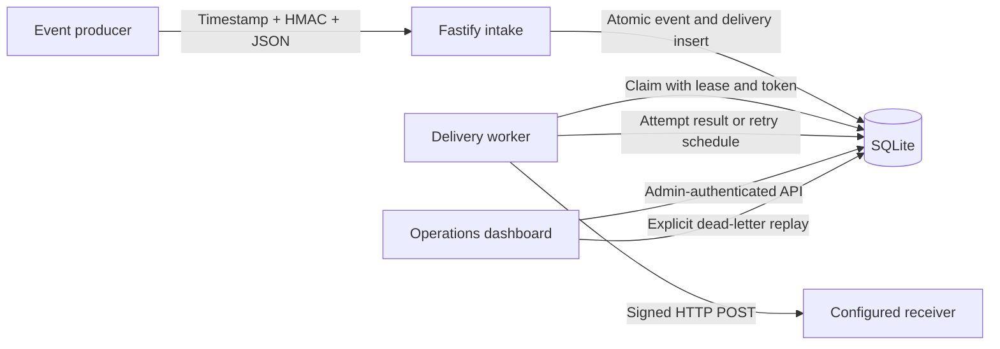
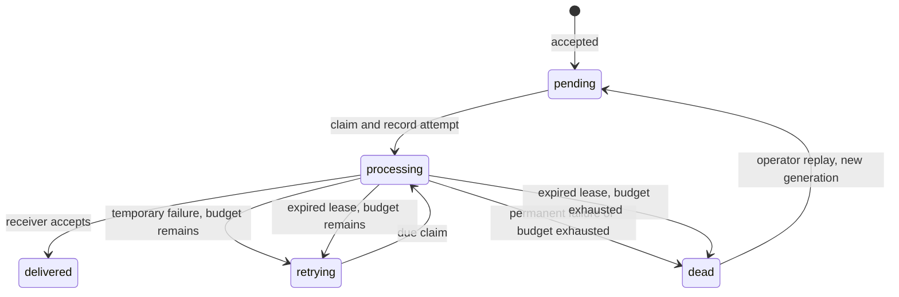

# Architecture and decisions

RelayDesk separates durable acceptance from delivery. The HTTP request waits for the intake transaction, not for the downstream receiver.

## Intake and identity

An event has an `id`, `type`, `occurredAt`, and JSON `data` object. The intake verifier authenticates the **raw bytes** rather than a reserialized JSON value. Its timestamp limits the useful lifetime of a captured signature; it does not replace durable duplicate detection.

After validation, canonical JSON gives objects a consistent key order. The same ID and canonical payload is a duplicate even if the producer reordered object keys. A repeated ID with different contents is an HTTP conflict. This rule applies to the entire event, including type and occurrence time; an ID should represent one immutable event.

The first event and its initial delivery are inserted in one transaction. A success acknowledgement follows the commit. The service can therefore restart with the queued work still present. A lost intake acknowledgement can cause the producer to resend; idempotent intake handles that resend.

Canonical comparison is not semantic domain equivalence. For example, changing a string amount from `"10.00"` to `"10"` changes the payload. Producers should preserve the event they originally sent.

## Delivery lifecycle

Claiming work changes its state, assigns a lease token, and starts an audit record in one database transaction. A completion is accepted only for the current token. If a lease expires, recovery marks the unfinished attempt abandoned and makes another attempt eligible, subject to its budget. The previous worker cannot overwrite the recovered attempt's outcome with a late response.

Token fencing protects local queue state. It cannot undo a network request already sent by a slow or interrupted worker. The receiver is responsible for deduplicating the stable delivery ID.

## Retries and replay

Temporary failures use exponential backoff within configured lower and upper bounds. A supported `Retry-After` value can defer a retry, also within the configured maximum. Permanent failures become dead immediately; temporary failures become dead when their attempt budget is exhausted. Defaults allow four attempts, with a one-second base delay and a thirty-second maximum delay.

Manual replay is an operator decision after investigating a dead delivery. It starts a new generation and resets that generation's attempt budget while preserving earlier audit records. Repeated clicks must not queue the same dead delivery twice. The event and its delivery identity remain stable across replay.

The failure classification, delay calculation, and replay behavior are tested separately from the HTTP boundary so a change to one is reviewable.

## The unavoidable acknowledgement gap

Consider this sequence:

1. The receiver performs the requested action.
2. The worker loses its connection or dies before recording the response.
3. The lease expires and another attempt delivers the event again.

The store cannot know whether step 1 happened. Recording a delivery as complete before sending would risk losing work; retrying risks duplicate effects. RelayDesk chooses at-least-once delivery and exposes abandoned attempts in the history.

A real receiver should use the delivery ID as an idempotency key and commit its receipt record and business effect together. An HTTP 200 only establishes that the receiver acknowledged the request. RelayDesk cannot certify the receiver's internal transaction.

## Security boundaries

- Incoming HMAC and outgoing HMAC use separate configuration secrets. Outgoing requests include a stable delivery identity for receiver deduplication.
- Administrative endpoints require an API key. This is a compact single-operator model, not a user management or tenant isolation system.
- The configured destination is not taken from JSON submitted by a producer. Redirects must not create an unreviewed alternate destination.
- The local dashboard uses text rendering for event data and keeps its key in memory rather than persistent browser storage.
- Public demo credentials and recovery controls exist to demonstrate the flow locally. They are not suitable for an Internet-facing deployment.

TLS protects transport in a real deployment. HMAC authenticates a message; it does not encrypt its data. Payloads and attempt metadata persist in SQLite, so access to the database file is access to that data.

## Why these choices

| Choice                  | Reason                                                            | Cost and next step                                                     |
| ----------------------- | ----------------------------------------------------------------- | ---------------------------------------------------------------------- |
| Fastify and TypeScript  | Small HTTP boundary with explicit types and runtime input checks  | Types do not validate network data by themselves                       |
| SQLite                  | Reproducible setup, transactions, and inspectable persisted state | Synchronous calls block the event loop; retain bounded operations      |
| Lease token             | Makes stale worker completion rejectable after recovery           | The external receiver still needs idempotency                          |
| One configured receiver | Keeps destination validation and the demo understandable          | Multiple destinations need ownership, credential isolation, and quotas |
| Visible retry history   | Makes recovery explainable to an operator                         | Define retention and redact sensitive payloads for real use            |
| Plain browser dashboard | Keeps backend behavior central and removes a frontend build step  | A larger product needs a richer auth and UI design                     |

Node's [`node:sqlite` documentation](https://nodejs.org/docs/latest-v24.x/api/sqlite.html) marks the Node 24 module Stability 1.2 (release candidate) and describes its synchronous database API. The built-in module removes an extra native database dependency from the setup. This is a deliberate tradeoff for a bounded reference service; a real deployment must review the chosen runtime and driver. It is not evidence of large-scale capacity.

## Deployment boundaries

The reference deployment is one application instance with a persistent local database volume. The tests include competition between two connections to the same database; they do not validate several application replicas across a network filesystem. Do not mount the same SQLite file into multiple containers as a scaling strategy.

Before a real deployment, decide:

1. Which producers and administrators may reach the endpoints, with HTTPS, reverse-proxy authentication, and rate limits.
2. How to provision, store, and rotate independent secrets. Rotation requires an explicit compatibility window and cannot be assumed from a configuration change alone.
3. Which outgoing hostname and addresses are allowed. A static HTTPS URL alone is not a complete defense against compromised configuration or DNS changes; apply an egress allowlist.
4. How to back up and restore SQLite, remove old payloads and audit rows, and restrict volume access.
5. How to monitor queue age, dead deliveries, disk capacity, and worker failures, with actionable alert thresholds.
6. How receivers persist idempotency records, how long they retain them, and what an operator replay means to their business process.

For larger volume or several workers on separate hosts, move the queue to a database or broker with a deployment model designed for that use. Measure latency and contention before choosing capacity targets.

## Useful review questions

- Which transaction must commit before intake acknowledges success?
- What happens when an identical event arrives while its first delivery is processing?
- What does a changed payload under an existing ID mean?
- Why does token fencing not guarantee exactly-once business effects?
- What happens if a receiver succeeds but the worker crashes before recording it?
- When should a permanent failure be replayed rather than fixed by sending a new event?
- Which SQLite and authentication decisions would change for a real client workload?
